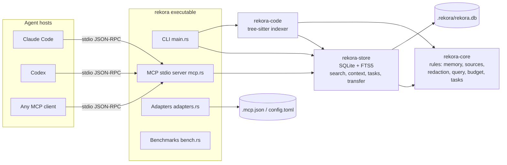

# Architecture overview

Rekora is a modular monolith: one executable, four crates, stdio by default.
Optional authenticated Streamable HTTP supports Docker and explicit network serving;
see [deployment](../DOCKER.md). No external service is required for local operation.

## Crates

| Crate | Owns | Depends on |
|---|---|---|
| `rekora-core` | What a memory/task is, trust rules, path policy, redaction, query terms, token budget | `blake3`, `regex`, `serde` |
| `rekora-store` | Schema + migrations, transactions, search/ranking, context packs, tasks, export/import, code-index tables | core, `rusqlite` (bundled SQLite) |
| `rekora-code` | File walk (`.gitignore`-aware), hashing, tree-sitter declaration extraction, snapshot checks | core, store, `ignore`, tree-sitter grammars |
| `rekora-cli` | Binary: CLI, MCP server (`rmcp`), host adapters, benchmarks, project discovery | all of the above |

Rules: no dependency cycles; core never knows about SQLite or MCP; the CLI holds no business rules.

## Request flow: `context` over MCP

1. Host sends `tools/call context {task, budget}`.
2. Server discovers the project from its start directory (main worktree via `git rev-parse --git-common-dir`).
3. Store opens `.rekora/rekora.db` (migrating if needed, with a snapshot).
4. Query → content terms → FTS5 OR-match over current memories in this scope → coverage floor →
   explained score (relevance × kind × status × freshness × branch).
5. Hits rendered one line each and packed whole into the budget; header marks them as data.
6. Result returned as structured content; errors as `isError` with a stable code.

## Where state lives

| Path | Content | In Git? |
|---|---|---|
| `<main worktree>/.rekora/rekora.db` (+ `-wal`, `-shm`) | Memories, sources, tasks, events, code index | No (`.rekora/.gitignore` = `*`) |
| `.rekora/rekora.db.vN.bak` | Snapshot before migrating from schema vN | No |
| `.rekora/backups/*.bak` | Host config files before adapter writes | No |
| `.rekora/adapters.json` | Which host configs Rekora changed | No |
| `<checkout>/.mcp.json` | Claude Code project MCP config (only if you install the adapter) | Your choice |
| `$CODEX_HOME/config.toml` | Codex user config (only if you install the adapter) | n/a |
